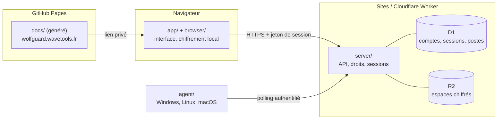

# Documentation WolfGuard

WolfGuard réunit dans une application web privée des mémos et procédures, des coffres personnels chiffrés et la gestion d’un parc de postes (scans réseau, protection antivirus, prise en main à distance). Ce dossier est la seule documentation du projet. **`docs/` est le site généré pour GitHub Pages, pas de la documentation.**

## Vue d’ensemble



| Dossier | Rôle |
| --- | --- |
| `app/` | Interface : vues, composants, styles, données de référence |
| `browser/` | Liaison avec l’API, chiffrement Web Crypto, reprise d’onglet |
| `server/` | API Worker, autorisations, stockage D1/R2, migrations |
| `agent/` | Agent installé sur les postes : scans, protection, bureau, terminal, fichiers |
| `scripts/` | Compilation du site, packaging des agents, contrôles de publication, suites de tests (`run-tests.mjs`) |
| `tests/` | Tests Node (API, agents) et tests navigateur Playwright sans fenêtre |
| `docs/` | Sortie de `npm run build` : ne jamais modifier à la main |
| `.github/workflows/` | Intégration continue : compilation et tests à chaque push |

## Démarrage rapide

```powershell
python -m pip install -r tests/requirements.txt
python -m playwright install chromium
npm run build          # exige la clé privée du lien, hors du dépôt
npm run test:node      # tous les tests Node, ~10 s
npm run preview        # http://127.0.0.1:4173
```

Le détail des contrôles par sujet est dans [Développement](developpement.md). La fin de chaque tâche (commit puis `git push origin main`) et l’intégration continue GitHub Actions sont décrites dans [Publication](publication.md).

## Parcours de reprise

1. [Reprendre le projet](reprise.md) : règles de travail à appliquer à chaque session.
2. [Architecture](architecture.md) : composants, flux d’une requête et fichiers à modifier.
3. [Décisions à conserver](decisions.md) : règles fonctionnelles en vigueur et historique des demandes.
4. [Développement et tests](developpement.md), puis [Publication](publication.md).

## Références par sujet

| Besoin | Document |
| --- | --- |
| Présentation courte du projet | [Projet](projet.md) |
| Fonctions de l’application et limites des scans | [Application](application.md) |
| Connexion, chiffrement, MFA, audit et limites de sécurité | [Sécurité](securite.md) |
| Antivirus intégré, composants et validation | [Antivirus WolfGuard](antivirus.md) |
| Groupes d’utilisateurs et droits des sections | [Droits](droits.md) |
| API, routes, stockage, migrations et déploiement | [Serveur](serveur.md) |
| Installateurs, services et prise en main | [Agents](agents/README.md) et [journal des agents](agents/journal.md) |
| Procédure facultative Authenticode | [Signature Windows](agents/signature-windows.md) |
| Suivi du rapport du 21 novembre 2026 | [Intégration du rapport](integration-rapport.md) |
| Nettoyage et dépannage | [Maintenance](maintenance.md) |

## Règles de documentation

- Le `README.md` de la racine est un simple renvoi vers cette page ; aucun README dans `server/`. Les notices `agent/LIRE-MOI*.txt` et les licences de `app/vendor/` et `server/vendor/` restent à côté des fichiers distribués.
- Mettre à jour la page concernée dans le même commit que le changement de comportement ; ne pas créer de copie concurrente.
- Les faits de sécurité se vérifient dans le code et les tests cités. Une date de contrôle n’est pas une garantie permanente.
