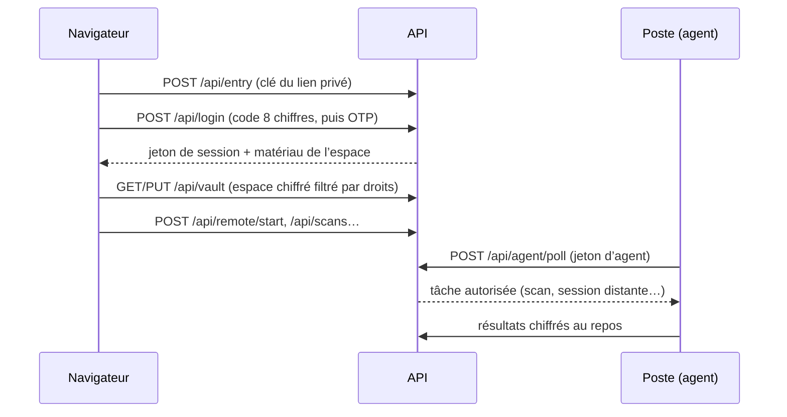

# Architecture et points d’entrée

## Composants

| Composant | Hébergement | Sources | Publication |
| --- | --- | --- | --- |
| Site statique | GitHub Pages, `https://wolfguard.wavetools.fr/` | `app/`, `browser/` compilés dans `docs/` | `git push origin main` |
| API | Worker Sites (Cloudflare), bindings `DB` (D1) et `BUCKET` (R2) | `server/` | Déploiement Sites distinct, voir [Serveur](serveur.md) |
| Agents | Postes Windows, Linux, macOS | `agent/`, archives dans `app/downloads/` | Packaging par `npm run build`, mise à jour autonome des agents |

## Circulation des données

Le navigateur charge le site GitHub Pages, vérifie le lien privé auprès de l’API, puis déverrouille le compte avec le code personnel et la MFA requise. L’API contrôle les permissions et échange les espaces chiffrés avec D1/R2. Les agents associés exécutent les opérations autorisées sur leurs postes et remontent leurs résultats à l’API.

## Traitement d’une requête API

`server/app/api/[...segments]/route.ts` transmet toutes les requêtes à `handleAPI` (`server/lib/wolfguard/core.mjs`). L’ordre des contrôles est le suivant :

1. **Adresse IP** : `CF-Connecting-IP` uniquement. Le contexte (IP et empreinte HMAC) est calculé une seule fois par requête (`addressContext`, `access.mjs`). Une IP bloquée manuellement ou listée par Spamhaus DROP reçoit `404 Adresse inconnue.` sur toutes les routes.
2. **Origine CORS** : seules `wolfguard.wavetools.fr`, `cantinbruno.github.io` et l’origine de l’API sont acceptées.
3. **Configuration** : D1, R2 et les secrets au format attendu, sinon `503`.
4. **Routage** : routes publiques d’entrée et de connexion, routes des postes (authentification propre), puis routes à session (`authorize`).
5. **Session** : jeton `Bearer` de 256 bits comparé par empreinte, inactivité de 4 h, plafond de 24 h, génération de l’espace, compte actif, MFA complète et IP non bloquée, vérifiés dans la même requête SQL.
6. **Droits** : `can()` et `requirePermission()` (`permissions.mjs`) sur chaque action, puis les droits par poste (`agent-access.mjs`).
7. **Réponse** : `Cache-Control: no-store`, CSP `default-src 'none'`, `X-Frame-Options: DENY`, HSTS en HTTPS, `Retry-After` sur 401/429. Les erreurs inattendues renvoient un message générique en `503`.

`issueSession` vérifie de nouveau l’IP avant et après l’écriture de la session, pour qu’un blocage simultané ne laisse pas de session ouverte.

## Routes de l’API

| Route | Authentification | Module |
| --- | --- | --- |
| `POST /api/entry` | Clé du lien privé | `core.mjs` |
| `GET /api/status` | Aucune | `core.mjs` |
| `POST /api/setup`, `POST /api/login` | Clé du lien privé (`X-WG-Entry`), puis code et OTP | `core.mjs`, `users.mjs`, `otp.mjs` |
| `POST /api/account/inspect`, `/api/account/complete` | Clé du lien privé et ticket d’invitation | `users.mjs` |
| `/api/agent/*` | Jeton d’agent (`Authorization: Agent …`) | `agents.mjs`, `remote.mjs`, `endpoints.mjs`, `ai.mjs` |
| `/api/agents*`, `/api/scans*`, `/api/remote/*`, `/api/edr*`, `/api/ai*` | Session + droits par poste | `agents.mjs`, `fleet-groups.mjs`, `remote.mjs`, `terminal.mjs`, `files.mjs`, `endpoints.mjs` |
| `/api/me`, `/api/users*` | Session + `users.*` | `users.mjs`, `access-groups.mjs`, `otp.mjs` |
| `/api/access*` | Session + `access.*` | `access.mjs`, `threat-list.mjs` |
| `GET /api/vault`, `PUT /api/vault`, `GET /api/storage/usage` | Session, projection selon les droits | `core.mjs`, `workspace-access.mjs`, `storage-usage.mjs` |
| `/api/chat/*` | Session | `chat-api.mjs`, `chat-history.mjs` |
| `POST /api/touch`, `POST /api/logout`, `POST /api/rotation` | Session | `core.mjs` |
| `GET /api/logs` | Session administrateur | `core.mjs`, `journal.mjs` |
| `POST /api/share/create`, `POST /api/share/revoke` | Session + `vault.secrets` | `share.mjs` |
| `POST /api/share/open` | Aucune (lien à usage unique de 128 bits) | `share.mjs` |
| `/api/duo/*`, `/api/push/*`, `/api/mfa/phone/*` | Retirées (Duo et notifications téléphone), réponse `410` | `core.mjs` |

## Modèle de données

Les migrations sont dans `server/drizzle/` (une migration par changement, jamais réécrite). Les valeurs sensibles sont chiffrées en AES-256-GCM avec un contexte (AAD) propre à chaque champ ; les identifiants recherchables sont des empreintes HMAC.

| Domaine | Tables D1 |
| --- | --- |
| Espace et sessions | `vault`, `sessions`, `rotations`, `login_throttle` (essais par IP) |
| Comptes et MFA | `users`, `user_invitations` (les tables Duo et téléphone sont supprimées par la migration 0022) |
| Droits | `access_groups`, `fleet_groups`, `permission_audit` |
| Accès réseau et journal | `access_connections`, `access_blocks`, `app_logs` |
| Liens de partage | `shared_secrets` (texte chiffré uniquement, supprimé à l’ouverture ou à l’expiration) |
| Postes et scans | `scan_agents`, `scan_pairings`, `scan_jobs`, `scan_intelligence` |
| Protection | `endpoint_states`, `endpoint_events`, `endpoint_policies`, `endpoint_commands` |
| Prise en main | `remote_sessions`, `remote_inputs`, `terminal_commands`, `remote_file_commands` |
| IA et discussion | `ai_jobs`, `chat_api_config`, `chat_api_usage`, `chat_conversations`, `chat_history_state` |

R2 contient les copies immuables de l’espace (`snapshots/…`, chiffrées par blocs de 64 Kio), les images de bureau temporaires (`remote/…`) et la liste Spamhaus (`security/spamhaus-drop-v1.json`).

## Où modifier

| Changement | Sources principales |
| --- | --- |
| Navigation, listes, éditeur et paramètres | `app/index.html`, `app/js/views/`, `app/js/ui/`, `app/css/` |
| Interface web et liaison avec l’API | `browser/adapter.js`, `browser/cloud.js` |
| Chiffrement et stockage du navigateur | `browser/crypto.js`, `browser/storage.js`, `browser/shared-workspace.js` |
| Reprise après rafraîchissement | `browser/tab-session.js` |
| Connexion et sessions côté serveur | `server/lib/wolfguard/core.mjs`, `session-policy.mjs`, `users.mjs` |
| TOTP et remplacement de téléphone | `server/lib/wolfguard/otp.mjs` et `browser/adapter.js` |
| Permissions communes | `server/lib/wolfguard/permissions.mjs`, `access-groups.mjs`, `group-membership.mjs` et `permission-store.mjs` |
| Filtrage des espaces et coffres personnels | `workspace-access.mjs`, `personal-vault.mjs`, `permission-store.mjs` dans `server/lib/wolfguard/` |
| Répartition du stockage et conservation des journaux | `storage-usage.mjs`, `retention.mjs` dans `server/lib/wolfguard/` |
| Protection des clés partagées | `server/lib/wolfguard/workspace-key.mjs` |
| Blocage d’IP et réputation Spamhaus | `server/lib/wolfguard/access.mjs`, `threat-list.mjs`, `threat-seed.mjs` |
| Association et autorisations des postes | `server/lib/wolfguard/agents.mjs`, `agent-access.mjs`, `fleet-groups.mjs` |
| Scans et réseau | `agent/network.mjs`, `agent/topology.mjs`, `agent/collect.ps1`, vues `app/js/views/scan-*` |
| EDR | `agent/endpoint*`, `agent/protect.ps1`, `server/lib/wolfguard/endpoints.mjs` |
| Antivirus WolfGuard | `agent/antivirus*`, `server/lib/wolfguard/antivirus-spec.mjs`, `app/js/ui/agent-protection.js` (onglet Protection de la fiche du poste) ; voir [couverture et limites](antivirus.md) |
| Bureau, terminal et fichiers | modules `remote*`, `terminal*`, `files*` dans `agent/` et `server/lib/wolfguard/` ; accord du poste dans `agent/remote.mjs` |
| Avis CERT-FR | `server/lib/wolfguard/certfr.mjs` et vues de rapports |
| Mise à jour d’un agent | `agent/update-command.mjs`, `agent/auto-update.mjs`, `app/js/agent-updates.js` |
| Compilation et publication statique | `scripts/build-web.mjs`, `scripts/package-agent.py`, `scripts/check-publication.mjs` |

Les noms de modules de la colonne serveur sont relatifs à `server/lib/wolfguard/` lorsqu’ils ne donnent pas de chemin complet. Les suffixes `*-spec.mjs` définissent les formats et limites partagés entre API et agents. Vérifier les fichiers présents avec `rg --files` avant d’ouvrir un module.

## Sources et fichiers générés

`scripts/build-web.mjs` copie l’interface dans `docs/`, produit les bundles navigateur, les empreintes SRI et la porte d’entrée chiffrée. Il copie le modèle de permissions du serveur vers `browser/permissions.js` et génère `app/js/agent-update-command.js` et `app/js/agent-uninstall-command.js`. Modifier d’abord les sources (`server/lib/wolfguard/permissions.mjs`, `agent/update-command.mjs`, `agent/uninstall-command.mjs`), puis reconstruire.

Le build applique aussi les protections du site publié : CSP sans `unsafe-inline` ni `unsafe-eval` pour les scripts, `script-src-attr 'none'`, refus de tout gestionnaire `on…=` dans le HTML et les scripts, SRI `sha384` sur chaque script et feuille de style, normalisation LF avant calcul des empreintes et document principal chiffré en AES-256-GCM avec la clé du lien privé.

Les archives et exécutables publiés dans `app/downloads/` et `docs/downloads/` proviennent du packaging. Ne pas les remplacer manuellement avec une version de test.

`server/` dispose de son propre `package.json`, de son lockfile et de sa chaîne de compilation Worker/Vinext. Le dépôt GitHub et l’hébergement API sont deux publications différentes.

Les 25 fiches de civilisations AoE IV et leurs ouvertures terrestres sont définies dans `app/js/data/aoe4-civilizations.js`. À l’ouverture de Mémo, `ensureUnifiedLibrary()` les ajoute dans la branche Jeux / AoE IV, ou retrouve une branche AoE existante sous Jeux. L’ajout est atomique avec les autres migrations et passe par le stockage chiffré habituel. Les fiches commencées sont reconnues par leur civilisation : leur identifiant et leurs métadonnées restent inchangés, et leur contenu est conservé sous « Notes déjà présentes ». Les notes de matchups ambiguës restent intactes. Le marqueur `aoe4-civilizations-guide-version` empêche les doublons et respecte les corrections ou suppressions ultérieures. Vérifications : `node --test tests/aoe4-civilizations.test.mjs` et `python tests/aoe4_civilizations_test.py` (navigateur sans fenêtre, compte de test uniquement).

## Arborescence conservée

Les dossiers de code n’ont pas été renommés : GitHub Pages publie `main:/docs`, et le build, les imports, le packaging, les agents installés (mises à jour depuis `docs/downloads/`) et les tests utilisent leurs chemins actuels. Un renommage casserait le site public ou les agents déjà déployés sans bénéfice fonctionnel.

Nettoyages des 26 et 27 novembre 2026 : retrait de sept catalogues de `app/js/data/` qui n’étaient plus chargés par aucune page (`command-basics*`, `coverage-catalog`, `fex-catalog`, `procedure-catalog*`, `protocol-catalog`), la validation par notification sur téléphone (`approve.html`, `push-*.js`, `server/lib/wolfguard/push.mjs`, `server/vendor/webpush.mjs`, tables Duo et téléphone), des scripts de surveillance et de synchronisation désactivés, d’outils visant un dossier d’anciennes versions disparu, d’une copie de `migrate-desktop.mjs` dans `server/scripts/`, et du gabarit d’interface du serveur (`components/`, `hooks/`, `examples/`, `components.json`, `lib/utils.ts`, `app/chatgpt-auth.ts`) avec ses dépendances npm. L’historique Git conserve ces fichiers. La documentation est rassemblée dans `documentation/`, avec des points d’entrée courts, et les sorties générées restent hors du contexte automatique de Continue.
